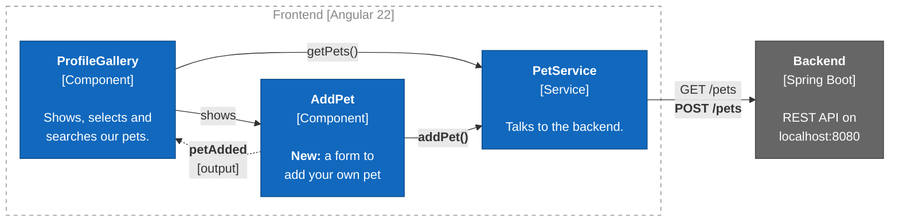

# Codelab05 - Adding your own pet

We have a default list of pets in our database, but what would Petinder be without the ability to show off your very own cute little fluffball? Let's create the option to
add your own pet to the database!

Keep your backend running while you work on this codelab, just like in codelab04.

## The big picture
Before we dive in, let's zoom out for a sec. These are the parts of Petinder you'll work on in this codelab, and how they talk to each other:

- A brand new `AddPet` component holds the form. Our `ProfileGallery` shows it, right below the search box.
- `AddPet` asks our `PetService` to add the pet, and the `PetService` sends it to the backend with a `POST /pets`.
- When that worked, `AddPet` tells the gallery with an *output*, `petAdded`. The gallery loads the pets again and selects the new one.
- The backend already knows how to save a pet, so we don't touch it.

## Posting a pet
- Adding a Pet means we will be performing a post through our backend API. Add another function called ``addPet()`` to the `PetService`.
  - It takes the Pet we want to add, and returns an `Observable<Pet>`: the backend answers with the pet it saved, including its brand new `id`.
  - `HttpClient` also has a `post` function: https://angular.dev/guide/http/making-requests#mutating-server-state
- Nothing calls `addPet()` yet, so nothing happens yet.

> Bonus: add a test to ``pet.service.spec.ts`` that checks that `addPet()` sends a `POST` with our pet in its body. The `GET` test you already have is a good starting point. `request.request.body` holds what was sent.

## A component of its own
Our `ProfileGallery` already shows, selects and searches pets. Let's not cram a form in there as well: the form gets a component of its own.

- Generate a component called `add-pet`, just like you generated the header and footer in codelab02.
- Show it in `profile-gallery.html`, right below our "Find your pet" section. The selector is in `add-pet.ts`.
- Don't forget to add `AddPet` to the `imports` of `ProfileGallery`.

Your browser should now show "add-pet works!" below the search box.

## Forms
Using our own input to create a Pet will happen through a Form. In codelab04 you bound a single input to a signal with `[(ngModel)]`. A form with a few fields, some rules and a submit button needs a bit more.

Angular has three ways to build forms:
- **template-driven forms**: `ngModel` on every input, like our search box.
- **reactive forms**: you build a `FormGroup` of `FormControl`s in your component. They've been around since the early days of Angular, and they're fully typed since Angular 14.
- **signal forms**: the new kid on the block, built on signals, and stable since Angular 22.

We'll go for signal forms. Want a peek at the other two? https://angular.dev/guide/forms

### The model
A signal form starts from a **model**: a writable signal that holds the data of our form. We want to create a Pet, so our model holds ... a Pet!

- Declare a field `newPet` in `add-pet.ts`: a signal that holds a `Pet`, just like `selectedPet` (minus the `undefined`).
  - It starts out as an "empty" pet: empty strings for the text fields, `0` for the numbers. TypeScript will tell you if you forgot a field :wink:
- Declare a field `petForm`, and create the form around our model with `form()`.
- The docs show you how: https://angular.dev/guide/forms/signals/models

The form doesn't keep its own copy of the data. Type something in the form, and `newPet` changes with it. Change `newPet` in your code, and the form shows it.

### The template
- Replace the content of `add-pet.html` with a section, with the same `tiny-dialog` styling as our "Find your pet" section.
- Put a `<form>` in it with an input for the name, kind, picture and profile text of our pet, and a submit button. The search box shows you the Bootstrap classes to use.
- Connect each input to its field of the form with the `[formField]` directive. We leave out `id` and `popularity`: the backend takes care of those.

> When adding an image to a pet, don't worry about usability. You'll have to type it as `images/filename.jpg`, using one of the images the backend already has (look in its `src/main/resources/images` folder). Uploading an image and storing it would take us a bit outside the scope of this codelab.

### Submitting
Time to send our pet to the backend! Have a look at the docs on form submission with `FormRoot`: https://angular.dev/guide/forms/signals/form-submission

Write the submit action:
- Call `addPet()` with the pet in our model. The action wants a `Promise`, but `addPet()` gives us an `Observable` ... Remember how our tests in codelab03 turned an Observable into a Promise?
  - That also *subscribes* to the Observable, and that matters: no subscribe, no request! Just calling `addPet()` sends nothing to the backend.
- When the pet is saved, empty the form: put the empty pet back in `newPet`.

Try it out in the browser: fill in a real pet (a name, and a cat, dog or chicken as kind) and submit. Nothing changes in the gallery yet ... but refresh the page, and there it is!

### Telling the gallery
Refreshing the page to see our pet is lame. Our pet is saved, but the gallery doesn't know about it yet. `AddPet` can't reach the pets of the gallery, and that's a good thing! A child component shouldn't mess with the insides of its parent. Instead, it tells its parent that something happened, with an **output**: https://angular.dev/guide/components/outputs

An output is the opposite of the `pet` input of our `PetProfile` from codelab04: an input brings data down from parent to child, an output sends it back up from child to parent.

- Declare an output `petAdded` in `AddPet` that carries a `Pet`.
  - Unlike our other fields, it's not `protected`: the gallery uses it from the outside.
- Once the pet is saved, `emit()` the pet the backend sent back.
- In `profile-gallery.ts`, write a method that does what the gallery should do with a new pet:
  - load the pets again: a resource can reload (https://angular.dev/guide/signals/resource#reloading)
  - select the new pet, so its profile shows up right away. That's what we sent the pet along for!
- Name it after what it does, not after the event: `showNewPet()` tells you more than `onPetAdded()` (https://angular.dev/style-guide#name-event-handlers-for-what-they-do-not-for-the-triggering-event)
- In `profile-gallery.html`, call it when `petAdded` fires on the `AddPet` component (https://angular.dev/guide/components/outputs#emitting-event-data)

Try it out in the browser: add a pet, and it should show up in the gallery, nicely sorted by name, and selected.

Did you see the gallery flash when you added your pet? For a moment, it showed "Loading pets..." again. That's our `@if (pets.isLoading())` from codelab03: a reload counts as loading too.
- Missed it? Our backend runs on your own machine, so it answers really fast. Open the Network tab, set the throttling to "Slow 4G", and add another pet.
- Our resource can tell the difference between loading for the first time and reloading: have a look at its `status()` (https://angular.dev/guide/signals/resource#resource-status).
- Only show "Loading pets..." the first time. While reloading, the gallery can keep showing the pets it already has.

Your pets live in the backend's in-memory database: restart the backend, and they're gone again.

### Validation
Now open the Network tab of your browser's developer tools, and try to add a fish :tropical_fish: Or a pet without a name. Our form happily sends it off, and the backend answers with a `400 Bad Request`. The backend has its own rules, and it's nicer to tell the user right away than to wait for an error from the backend.

Add these rules to your form:
- A pet needs a name.
- A pet needs a kind, and only the kinds our backend knows. Which ones are those? Have a look at `Kind.java` in the backend.

Some pointers:
- The docs show you where your rules go, and which validator functions Angular has: https://angular.dev/guide/forms/signals/validation
- Is "Dog" with a capital D a valid kind? Check what the backend does with it.
- Give every rule a message a user understands.

Now show those error messages below their input. Nobody likes being yelled at before they've even started typing, so only show them once the user has `touched()` the field.
- Bootstrap 3 turns a `form-group` red when you give it the class `has-error`. You know how to add a class from codelab04!

Now add a real pet. Hmm, after a successful submit, the empty form is all red ... We put an empty pet back in our form, but its fields are still `touched()`, and an empty name is an invalid name. Have a look at what a field can do, and `reset()` the form after you emptied it.

Try that fish again: your form should stop it, and no request goes out. A real pet still makes it to the gallery.

After going through all these steps, you'll be able to add your very own pet to our Petinder app! :tada:

## Testing
Our form has rules, so let's prove they work. No code given this time either!

The CLI generated an `add-pet.spec.ts` for you. Add these tests there:
- **A pet needs a name**: fill in a kind but no name, submit the form, and check that your error message is shown and that no pet was posted.
- **Only known kinds**: fill in a name and a kind the backend doesn't know (a fish, say), submit, and check that your error message is shown and that no pet was posted.

Some pointers:
- Our form talks to the backend, so the test needs the same fake backend as `profile-gallery.spec.ts`: `provideHttpClientTesting()` and an `HttpTestingController`.
- Your tests from codelab04 already show you how to type in an input. Our form inputs work the same way.
- To submit the form, click its button.
- `httpTesting.expectNone()` checks that a request was *not* sent. Have a look at what it accepts: you can match on the method too.

> Bonus: test the happy path too.
> - In `add-pet.spec.ts`: fill in a valid pet, submit, check that the `POST` went out, and answer it with `flush()`. Did `petAdded` fire with the saved pet? You can `subscribe()` to an output in your test: check the outputs docs.
> - In `profile-gallery.spec.ts`: make the `AddPet` inside the gallery emit a pet, and check that the gallery loads its pets again and selects the new one. `fixture.debugElement.query(By.directive(AddPet))` finds it for you.
> - Heads-up: the reload only sends its request after a `TestBed.tick()`, just like in our `beforeEach`.

Run `ng test`. Green? Now remove one of your rules for a moment: your tests should turn red.

### Commit your work
You know the drill.

## Conclusion
You've learned:
- how to send data to the backend with `http.post`.
- that Angular has three kinds of forms: template-driven, reactive and signal forms.
- how to build a signal form with `form()` and `[formField]`.
- how to add rules with a schema, and show their error messages.
- how to submit a form with `[formRoot]` and a submit action.
- how a child component tells its parent something with an `output()`.
- how to reload an `rxResource`.
