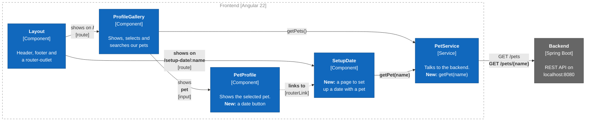

# Codelab06 - Adding Routing to your app

Petinder starts looking like a real app by now. We have our list of pets. We can filter them by name. We can see our chosen pet's name and profile text. We can even
add our own pets to the app!

However, there is one elementary thing missing from our app. We can't arrange a date yet!

Keep your backend running while you work on this codelab, just like in codelab05.

## The big picture
Before we dive in, let's zoom out for a sec. These are the parts of Petinder you'll work on in this codelab, and how they talk to each other:



- Our app gets a second page: a brand new `SetupDate` component, with a URL of its own.
- The router decides which page goes in the `<router-outlet />` of our `Layout`: the gallery on `/`, the date page on `/setup-date/:name`.
- `PetProfile` gets a button that *links* to the date page of the selected pet.
- The date page reads the pet's name from the URL, and asks our `PetService` for that pet. The `PetService` gets it from the backend with a `GET /pets/{name}`.
- The backend already knows how to find a pet by name, so we don't touch it.

## The date component
We've been showing all the content in just one single 'screen' until now, bound to the 'root' of our webapp: http://localhost:4200.

For this new date component, we want to show it in a new screen, with its own URL: http://localhost:4200/setup-date/name-of-your-pet.

The application flow will be as follows:
- on the home screen, click a pet
  - its profile pops open to the right, with a date button below it
  - click the date button
- navigate to the setup date screen, with its own URL
  - it shows the pet you picked

### Creating the new component
Generate a component called `setup-date`, just like you generated the `add-pet` component in codelab05.

Nothing shows it yet. Let's change that!

### Defining a route
Remember the `app.routes.ts` file from codelab03? That's where you told the router to show our `ProfileGallery` on the root of our app, the empty path `''`.
- It's a list of routes: each route maps a path to the component to show.
- The `provideRouter(routes)` in `app.config.ts` hands that list to Angular's router.
- The router shows the component of the current URL in the `<router-outlet />` of our `Layout`. That's why the header and footer stay put.

Add a route for our `SetupDate` component:
- It should point to `setup-date/{name}`, and of course load the `SetupDate` component.
- You'll notice that `{name}` needs to change depending on the pet we're trying to set up a date with.
  - This is called a **route parameter**.
  - Find out how to put one in your path: https://angular.dev/guide/routing/define-routes#define-url-paths-with-route-parameters

Try it out: surf to http://localhost:4200/setup-date/Princess. Instead of the gallery, you should see "setup-date works!" between the header and the footer.

### Creating links using 'Router links'
Typing URLs is not what our users want to do, of course. Let's give them a button.

Add it to `pet-profile.html`, right below the profile text. It can look like this:
```html
<div class="dialog-centered">
  <a class="btn btn-primary btn-lg">Set up a date</a>
</div>
```

- This adds the button to our app, but of course it doesn't go anywhere yet.
- To fix this, we'll use the `routerLink` directive: https://angular.dev/guide/routing/navigate-to-routes#how-to-use-routerlink
  - Make sure the link points to `/setup-date/name-of-your-pet`, with the name of the pet our `PetProfile` shows.
  - Gluing strings together works, but `routerLink` also takes an array of URL parts. Have a look at the *link parameters array*: https://angular.dev/guide/routing/common-router-tasks#link-parameters-array
  - `routerLink` is a directive, just like `ngModel` was: add `RouterLink` to the `imports` of `PetProfile`.

### Sanity check
With the route configured and the button set up, you should now be able to navigate from the home screen to the setup date screen:
- click a pet, then the date button
- the URL changes to http://localhost:4200/setup-date/name-of-your-pet, and you see "setup-date works!"
- hit the back button of your browser, and you're back in the gallery

Now run `ng test`. Uh oh: some of your older tests are red, with `NG0201: No provider found for ActivatedRoute`.
- `routerLink` needs a router to work with. Our app has one (`provideRouter` in `app.config.ts`), but our tests don't.
- Add `provideRouter([])` to the `providers` of the tests that show a `PetProfile`. An empty list of routes will do: we only need the links to render.

## Reading the name from the URL
Now that the navigation between 'screens' is working, we want to add behavior to the setup date screen.

We've navigated to the date component to set up a date with a specific pet. To show this specific pet, we'll first need to get its name from the URL.

Remember the `pet` input of our `PetProfile`? The gallery hands it a pet from its template. Our router can fill an input too: with the value of a route parameter!
- Tell the router to do so: add `withComponentInputBinding()` to `provideRouter` in `app.config.ts`.
- Add an input `name` to `SetupDate`. It's always there in our route, so it can be `required`.
  - Its name has to match the name of your route parameter.
  - Just like `pet`, it's not `protected`: someone from the outside (the router) fills it.
- More info: https://angular.dev/guide/routing/common-router-tasks#getting-route-information

Show `{{ name() }}` in `setup-date.html` for a moment, and navigate to a date with a pet: you should see its name.
- Getting `NG0950: Input "name" is required but no value is available yet` in your console? The router doesn't fill your input. Check `withComponentInputBinding()` and the name of your route parameter.

> Input binding came with Angular 16, in 2023. Before that, a component had to read the URL itself through `ActivatedRoute`, so you'll still run into it a lot in existing code: `route.params.subscribe(...)` or `route.snapshot.paramMap.get('name')`. It does the same job: https://angular.dev/guide/routing/read-route-state#route-parameters

## Fetching the pet
Next we'll need to fetch the actual pet from the backend. You should know how to do this by now :wink:

- Our backend can find a pet by its name: have a look at `PetController.java`.
- Add a function `getPet()` to our `PetService`: it takes the name, and returns an `Observable<Pet>`.
- In `SetupDate`, load the pet with an `rxResource`, just like our gallery loads its pets.
  - There's one difference: this resource depends on our `name` input. Have a look at `params`: https://angular.dev/guide/signals/resource
  - The example uses `resource()` with a `loader`. `rxResource` works the same way, with a `stream` instead.
  - Angular remembers that your `params` read `name()`. When the name changes, the resource loads the new pet all by itself!

## Showing the pet
Time to make our date page look good.
- Copy the content of [`setup-date.html`](setup-date.html) into the `setup-date.html` of your app, replacing "setup-date works!".
- Show the picture, the name and the profile text of our pet. Our gallery shows you how to get a picture from the backend.
- While the pet is loading, `pet.value()` has no pet yet. A resource's `hasValue()` tells you when it does: check out the example on the resource page above.
- Show a loading message and an error message, just like our gallery does since codelab03.
- The "Back to the gallery" button should take us back to the gallery. You know how to do that by now!
  - Heads-up: a plain `routerLink="/"`, without square brackets, looks like any other HTML attribute to Angular. Forget to import `RouterLink`, and Angular won't complain: your button just doesn't do anything.

### Sanity check
Navigating to the setup date screen should now show the pet's picture, name and profile text. Let's try a few more things:
- **Reload the page** on http://localhost:4200/setup-date/Princess. Princess is still there! Everything our page needs is in its URL. That's called a *deep link*: you can bookmark it, or send it to a friend.
- **Try a pet that doesn't exist**, like http://localhost:4200/setup-date/Nobody. Open the Network tab: the backend answers with a `404 Not Found`, and your page should show your error message.
- **Use the buttons**: "Back to the gallery" takes you home, and your browser's back and forward buttons go back and forth between the two pages.

Do not worry about actually setting up a date yet. That's something for a later codelab!

> Bonus: right now, a user downloads the code of our date page as soon as they open Petinder, even if they never set up a date. A route can also *lazy load* its component: only when someone navigates to it.
> - Have a look at `loadComponent`: https://angular.dev/guide/routing/loading-strategies#lazily-loaded-components-and-routes
> - Did it work? `ng serve` now lists a "Lazy chunk file" for `setup-date`, and the Network tab shows it being downloaded when you click the date button.

## Testing
Time to prove our date page works. No code given this time either!

Run `ng test`: the `should create` test the CLI generated in `setup-date.spec.ts` is red.
- First you'll see `NG0201` again: our date page has a `routerLink` too.
- Give it a router like before, and you get `NG0950`: the test creates a `SetupDate` all by itself, so nobody fills its `name`.

Turn it into this test:
- **The date page loads the pet named in the route**: navigate to `/setup-date/` with the name of a pet, check that the pet with that name was requested from the backend, and that its name and profile text end up on the screen.

Some pointers:
- Angular has a `RouterTestingHarness` that navigates in your tests just like a user would: https://angular.dev/guide/routing/testing#route-parameters
  - The example makes up its own routes. Why not use the real `routes` from `app.routes.ts`?
  - Don't forget `withComponentInputBinding()`: your test needs it just as much as your app does.
- Our page talks to the backend, so the test needs our fake backend again: `provideHttpClientTesting()` and an `HttpTestingController`.
- After a `flush()`, `await harness.fixture.whenStable()` before you check the page.
- `harness.routeNativeElement` is the page our router shows.

> Bonus:
> - add a test to `pet.service.spec.ts` that checks that `getPet()` sends a `GET` to the right URL.
> - add a test to `pet-profile.spec.ts` that checks that the date button links to the right page. The `href` attribute of the link tells you where it goes.

Run `ng test`. Green? Now remove `withComponentInputBinding()` from your test for a moment: your test should turn red.

### Commit your work
You know the drill.

## Conclusion
You've learned:
- how to add a route with a route parameter to `app.routes.ts`.
- how to create links to a route using `routerLink`.
- how to read a route parameter in a component with `withComponentInputBinding()` and an `input()`, and that existing code often uses `ActivatedRoute` instead.
- how to load data that depends on a signal with the `params` of a resource.
- what a deep link is.
- how to test a routed component with the `RouterTestingHarness`.
